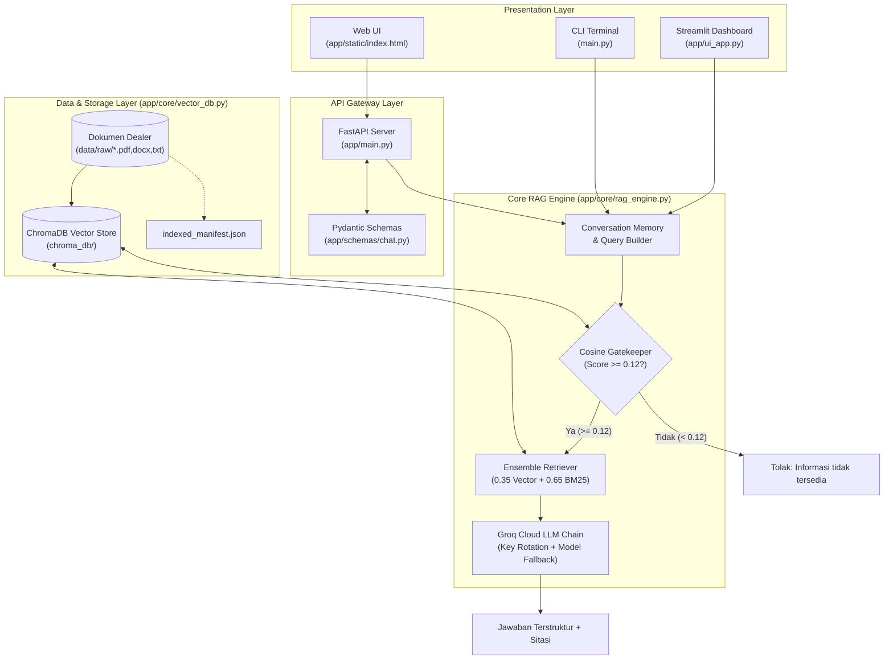
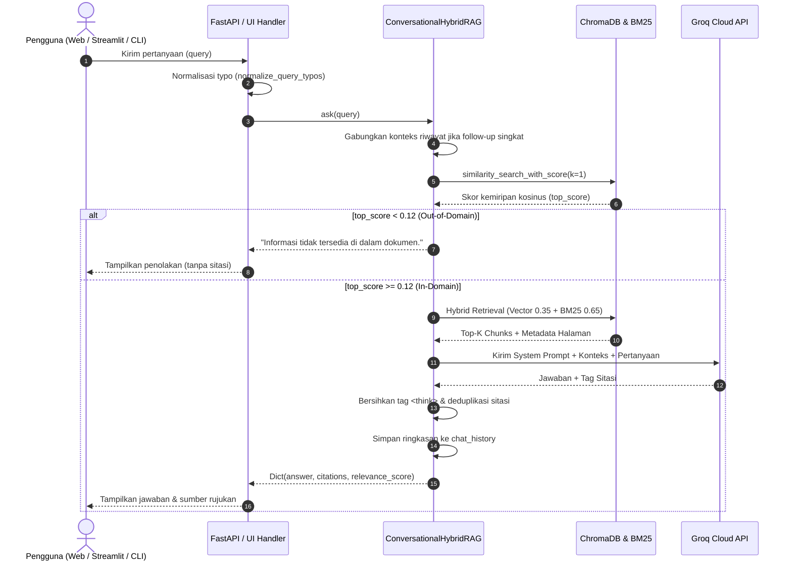
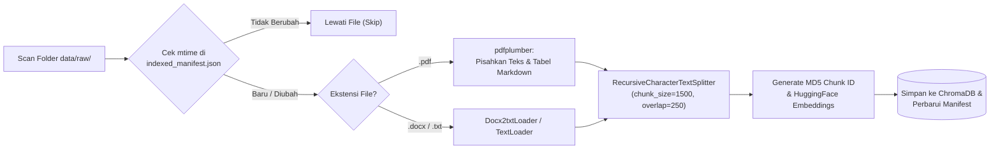

# 📊 Diagram Alur Sistem — Suzuki Cinere Hybrid RAG

Dokumen ini menyajikan visualisasi alur pemrosesan data (*ingestion*), alur tanya-jawab (*inference pipeline*), dan arsitektur komponen menggunakan sintaks **Mermaid**.

---

## 1. Diagram Arsitektur Komponen Sistem

---

## 2. Diagram Alur Inferensi & Anti-Halusinasi (*Sequence Diagram*)

---

## 3. Diagram Pipeline Ingesti Dokumen (`sync_documents`)

